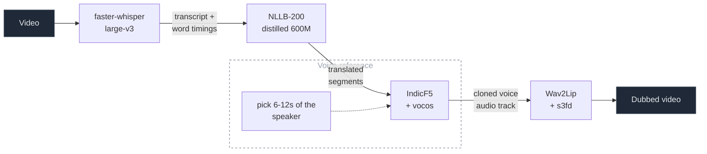
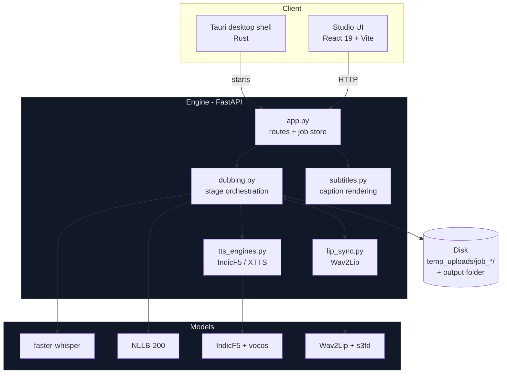
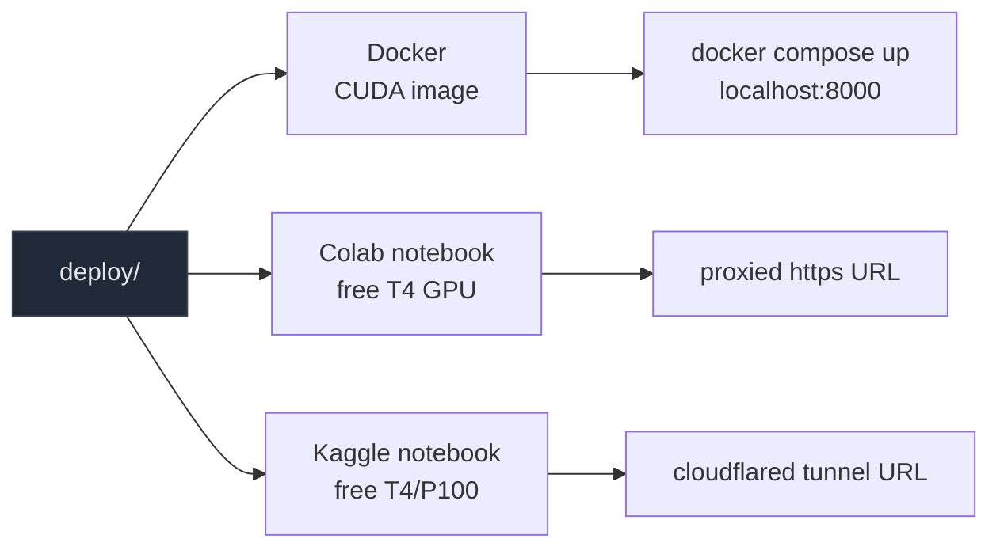

# Multiva

Offline video dubbing for Indian languages. Point it at a talking-head video,
pick a language, and get the same person saying the same thing in that language
— in a voice cloned from their own, with the mouth re-synced to match. Nothing
is uploaded: no API key, no per-minute cost, no account.


---

## How it works

Four models, in order, each handing the next what it needs and nothing more.



| Stage | Model | Device | What it contributes |
|---|---|---|---|
| Transcribe | faster-whisper large-v3 | CPU | Words with timestamps, VAD-gated so silence is never heard as speech |
| Translate | NLLB-200 distilled 600M | MPS / CUDA | One segment at a time, code-switching repaired afterwards |
| Clone & speak | IndicF5 + vocos | MPS / CUDA | The speaker's voice, from a 6–12 s reference the pipeline picks itself |
| Lip sync | Wav2Lip + s3fd | MPS / CUDA | The mouth region only, composited back with a feathered mask |

Whisper stays on the CPU because CTranslate2 has no Metal backend; everything
else shares the GPU, one heavy stage at a time. A second output for the same
clip — a subtitled video after a dub, say — reuses the transcript and the
translation, so it takes seconds rather than minutes.

### System architecture



Three processes on one machine. The Tauri shell finds the checkout, starts the
engine with the project's own Python, shows a splash until the models are
loaded, then opens the studio. The studio is the interface — Projects, Models,
and the Media / Edit / Deliver pages of a project. The engine is the job store
and the pipeline: it writes a manifest per project so everything reopens after a
restart, and files the finished output where you asked.

There is no database and no object store. Settings live in `~/.multiva/`,
working files in `temp_uploads/job_*/`, finished renders in your output folder.

---

## Deploy on a GPU

The engine picks its device automatically — CUDA, then Apple silicon, then CPU.
On CPU the same code runs correctly, just slowly: voice synthesis is a diffusion
transformer sampled per phrase, so a GPU is the difference between a render
taking under a minute and taking several. Nothing in the code needs changing; it
needs a GPU. Three ways to get one, all in `deploy/`:



### Colab and Kaggle

Two notebooks, same steps, one for each host. Open the one you want, select a
**GPU runtime**, then **Run all**:

| Notebook | Where it writes | How you open the UI |
|---|---|---|
| [`deploy/notebooks/colab.ipynb`](deploy/notebooks/colab.ipynb) | `/content/multiva-runtime` | Colab's own port proxy, printed by the notebook |
| [`deploy/notebooks/kaggle.ipynb`](deploy/notebooks/kaggle.ipynb) | `/kaggle/working/multiva-runtime` | a Cloudflare quick tunnel, started by the notebook |

Each notebook clones the repo, checks the GPU, redirects the runtime directories
to a writable volume, installs the CUDA PyTorch build and the rest of
`requirements.txt`, fetches the models, starts the server in a background thread
of the kernel, prints the public URL, and stops the server at the end.

> Kaggle: turn **Internet** on in the notebook settings, or the clone, the
> install and the model downloads all fail.

### Docker

```bash
docker compose -f deploy/docker/docker-compose.yml up --build
# then open http://localhost:8000/app/
```

A CUDA 12.4 image with the whole pipeline. The compose file reserves a GPU
through the NVIDIA Container Toolkit; without one, delete that block and it runs
on CPU. Uploads, renders and the Hugging Face cache live in a named volume
(`/data`), so a rebuild does not re-download 7.5 GB of weights. Set `HF_TOKEN` in
a `.env` beside the compose file to unlock the gated voice model.

To build the image directly:

```bash
docker build -f deploy/docker/Dockerfile -t multiva:latest .
docker run --gpus all -p 8000:8000 -v multiva-data:/data multiva:latest
```

`deploy/docker/entrypoint.sh` also takes `models` (fetch weights and exit) and
`shell` (a shell in `/app`).

---

## Install locally

Python 3.10, ffmpeg, and Rust. Multiva is a desktop application: the studio is a
native window and Rust builds it once. The interface files ship built in `web/`,
so Node is only needed to change them.

```bash
# macOS:  brew install python@3.10 ffmpeg
# Ubuntu: sudo apt install python3.10 python3.10-venv ffmpeg fonts-noto-core fonts-noto-cjk
# Rust:   curl --proto '=https' --tlsv1.2 -sSf https://sh.rustup.rs | sh

git clone https://github.com/gajjalaashok75-UI/video-dubbing
cd video-dubbing
./run.sh
```

On a fresh clone `run.sh` offers to build the Python environment, fetch the
models (about 7.5 GB, resumable, every file checked against a SHA-256) and build
the window, asking once for each. It starts Ollama if it is installed and opens
the studio when the engine is ready.

> **One model needs a free Hugging Face account.** The voice model,
> `ai4bharat/IndicF5`, is a *gated* repo: accept its licence on the model page,
> put a read token in `.env` as `HF_TOKEN`, and the downloader fetches it like
> any other model. Without a token it is skipped without error and the Indian
> languages are marked unavailable — transcription, translation, subtitles and
> lip sync all still work. Steps: [docs/GATED-MODELS.md](docs/GATED-MODELS.md).

By hand instead:

```bash
python3.10 -m venv venv
./venv/bin/pip install -r requirements.txt
cp .env.example .env                              # set HF_TOKEN for the gated voice model
./venv/bin/python scripts/download_models.py      # --check reports without downloading
cd apps/studio && npx tauri build                 # the window, once
```

### Run

```bash
./run.sh                    # local script model through Ollama
./run.sh --provider groq    # a hosted script model instead
./run.sh --fresh            # as a brand-new user, without touching your setup
./run.sh --setup            # install everything and exit, without starting
./run.sh --setup --yes      # the same, unattended
```

Everything runs on this machine. The engine listens on `127.0.0.1` only, and the
one thing that can leave it is a line of already-translated text, and only if you
choose a hosted script model.

---

## What you get

| Output | What it is | Needs a voice model |
|---|---|---|
| **Dub video** | Transcribe, translate, clone the voice, re-sync the lips | yes |
| **Dub audio only** | The same, without lip sync — for a speaker off camera | yes |
| **Subtitled video** | Your video back with subtitles drawn on, timed to the dialogue | no |
| **Translated subtitles** | The `.srt` / `.vtt` on its own | no |
| **Subtitles, source language** | Transcribe only. The fastest thing here | no |
| **Voice-over** | Speak your own script in the cloned voice | yes |

The studio is a docked editor — media pool, viewer, inspector, timeline, status
bar — with real decoded waveforms. Every project keeps all of its outputs
together and reopens with its phrase timeline intact.

- **Edit any phrase.** Change the words, re-speak just that line. The rest come
  from a per-phrase cache. Undo restores the previous take byte for byte.
- **Re-roll a delivery** with a new seed; synthesis is seeded so a re-run is
  reproducible.
- **Choose the reference window** the voice is cloned from, instead of accepting
  the automatic pick.
- **Trim** with in and out points, and lay a **music bed** under the result.
- **Cancel** a render — cooperative, and it lands within about one phrase.

Subtitles are drawn with a font that actually holds the script — every Indian
language, Arabic and Urdu right-to-left, CJK — and the self test checks each one
on the machine it runs on.

---

## Test

```bash
./venv/bin/python scripts/selftest.py path/to/clip.mp4     # a real dub, several minutes
./venv/bin/python scripts/selftest.py                      # a minute, nothing rendered
```

Over 150 checks against the running engine: a real dub, the phrase editor,
re-rolling a take, a different reference window, a re-render, a subtitled video
in a chosen language, a second output rendered from a reopened project, every
export, a voice-over, a cancellation that actually stops, and a font for every
script. Anything needing a model you have not configured is skipped rather than
failed.

---

## Results

Measured across 21 clips (Hindi, English and mixed; 368p–1080p; portrait and
landscape) with `engine/eval_harness.py`.

| | n | speaker similarity | dub CER | pace | A/V sync |
|---|---|---|---|---|---|
| same-language re-voice | 7 | 0.912 | 0.088 | 0.76 | 0 ms |
| cross-lingual dub | 14 | 0.878 | 0.158 | 0.99 | 0 ms |

*Speaker similarity is a WavLM x-vector cosine rescaled per clip between a floor
(the reference vs a different speaker) and a ceiling (the reference vs the
speaker's own audio). CER re-transcribes the dub and compares it to the text the
pipeline intended to say — the closest automatable proxy for "can a listener
follow this".*

Every render scores itself: the studio reports speaker similarity and A/V drift
per job, so a bad run is visible before you play it.

## Known limits

- **Slow on CPU.** Voice synthesis dominates; a GPU is strongly recommended. See
  [Deploy on a GPU](#deploy-on-a-gpu).
- **One voice per video.** Whisper does not diarize, so multi-speaker footage
  gets a single cloned voice. This is the largest capability gap.
- **Talking-head video only.** Wav2Lip needs a visible, roughly front-facing
  face, and generates a 96×96 mouth — the most visible weakness on 1080p.
- **The voice model is gated** and needs a Hugging Face token, as above.
- **Burned subtitles use the fonts already on the machine.** Ubuntu needs
  `fonts-noto-core` (and `fonts-noto-cjk` for CJK) or captions come out as boxes.
- **Translation on poetry and heavy code-switching is weak;** NLLB is a
  sentence-level model.

---

## Project layout

```
apps/studio/        the studio: React 19 + Vite + Tailwind v4, and the Tauri shell
engine/             the engine: FastAPI service, the four stages, subtitles, projects
  app.py            every route, the job store, the pipeline
  deploy_helpers.py runtime helper the Colab/Kaggle/Docker paths share
  vendor/f5_tts/    the f5_tts fork the IndicF5 checkpoint was trained with
  vendor/wav2lip/   the Wav2Lip source the lip-sync stage imports (weights downloaded)
  assets/floor/     the unrelated voices the voice-match score is anchored on
web/                the built interface, committed so Node is not required
scripts/            selftest.py · download_models.py · fit_bench.py · reference_experiment.py
deploy/
  docker/           Dockerfile · docker-compose.yml · entrypoint.sh
  notebooks/        colab.ipynb · kaggle.ipynb
docs/               ARCHITECTURE.md · TESTING.md · GATED-MODELS.md · plans and audits
run.sh              the one command
```

[docs/ARCHITECTURE.md](docs/ARCHITECTURE.md) walks the pipeline stage by stage
and lists the traps that will silently break it if disturbed.
[docs/TESTING.md](docs/TESTING.md) is the manual test script.
[docs/GATED-MODELS.md](docs/GATED-MODELS.md) is how to unlock the gated voice
model.

---

## License and attribution

Built and maintained by **Ashok Gajjala**.

This project builds on the work of others, used under their own licences:
[faster-whisper](https://github.com/SYSTRAN/faster-whisper),
[NLLB-200](https://huggingface.co/facebook/nllb-200-distilled-600M),
[IndicF5](https://huggingface.co/ai4bharat/IndicF5),
[F5-TTS](https://github.com/SWivid/F5-TTS),
[Wav2Lip](https://github.com/Rudrabha/Wav2Lip), and
[Vocos](https://github.com/charactr-platform/vocos).

The optional XTTS engine is under the Coqui Public Model License, which is
non-commercial; it is not installed by default.
